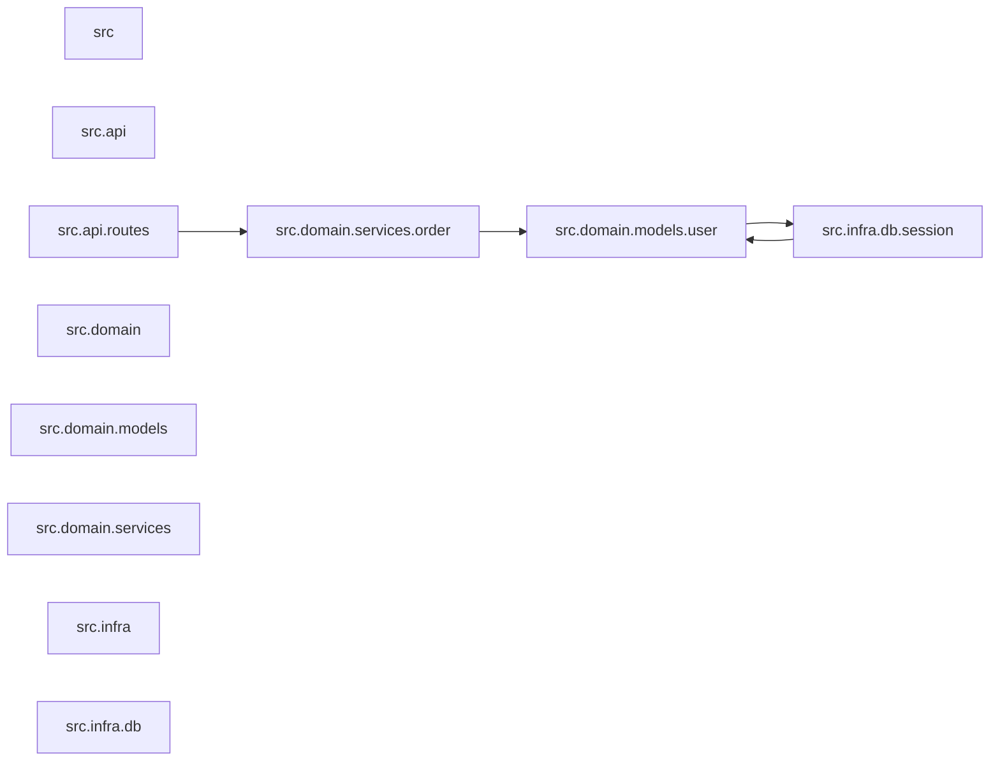

<!-- skill: architecture-map | schema: 1 | generated: python .claude/skills/architecture-map/scripts/extract_py.py --root . --level module --out .skills/cache/architecture-map/service-module.json -->

# ARCHITECTURE.md - cyclic-imports (Fixture-Service)

## Kontext

Kleines Python-Paket unter `src/`. Keine externen Abhaengigkeiten (`external` ist leer)
- dieses Fixture-Beispiel besteht ausschliesslich aus internem Code. Einstiegspunkt ist
konzeptionell `src/api/routes.py` (die einzige Datei, die von ausserhalb des Pakets
angesprochen wuerde).

## Module

Vier Bereiche sind hier sichtbar: `src.api` (Fassade), `src.domain.services`
(Anwendungslogik), `src.domain.models` (Domaenenobjekte) und `src.infra.db`
(Persistenz). `src.api.routes` ist der Einstiegspfad fuer Neue.

### Befunde

- **Zyklus:** `src.domain.models.user` <-> `src.infra.db.session`. `user.py` ruft
  `get_session()` aus `session.py` auf; `session.py` importiert `User` fuer die
  `audit()`-Funktion zurueck. **Einschaetzung:** real problematisch, keine bewusste
  Ausnahme - eine Domaenenklasse haengt von der Persistenzschicht ab, und die
  Persistenzschicht kennt die Domaenenklasse zurueck. Keine Seite ist unabhaengig
  testbar. Empfehlung: `audit()` sollte `user_id: str` statt `User` annehmen, dann
  entfaellt die Rueckkante.
- Keine Ausreisser bei Fan-in/Fan-out (Schwellen: Default 10/10, keine `layers.json`
  vorhanden - Schichtverletzungen sind entsprechend ungeprueft, nicht sauber).

## Klassen

Keine Hotspot-Auswahl fuer dieses kleine Fixture-Beispiel - die Klassen (`User`,
`OrderService`) verteilen sich klar auf ihre Module, ein Klassendiagramm braechte hier
keinen zusaetzlichen Erkenntniswert gegenueber der Modulebene.

---

<!-- architecture-map:graph-hashes
{"module": {"command": "python .claude/skills/architecture-map/scripts/extract_py.py --root . --level module --out .skills/cache/architecture-map/service-module.json", "graph_hash": "6fd5226f670cb2c04447fc60a95f7b9c490cfe620601e08b719d83932d9eb1a4"}}
-->
